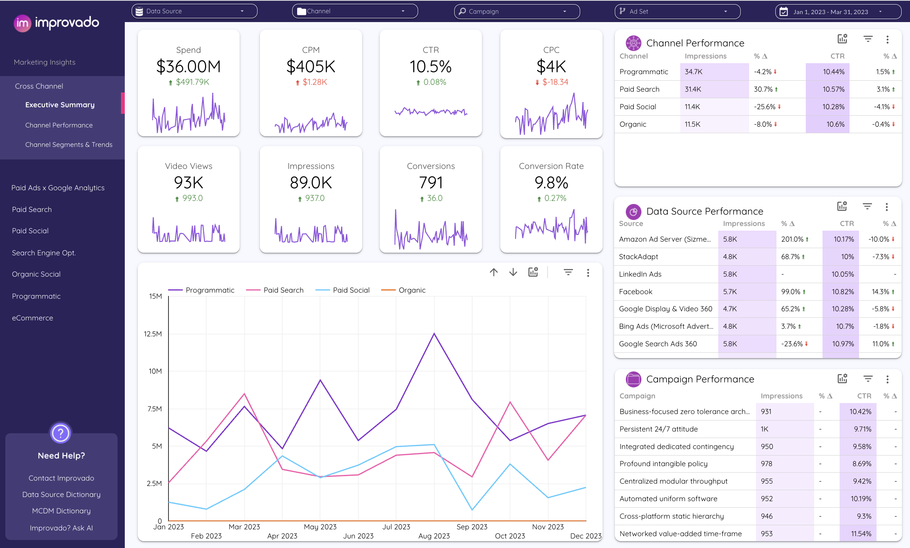

# Marketing Analytics Dashboard

A polished Streamlit dashboard for exploring cross-channel marketing performance.
It was built as a technical customer success demonstration and uses a fully
synthetic, deterministic marketing dataset—no real customer, campaign, or
credential data is included.



## Capabilities

- Global filters for date range, data source, channel, campaign, and ad set.
- Eight KPI cards with prior-period comparisons and Plotly sparklines.
- Channel, data source, and campaign performance tables.
- Monthly channel trend chart for Programmatic, Paid Search, Paid Social, and Organic.
- Reproducible daily data for all of 2023 with realistic seasonality and channel profiles.

## Technology Stack

- Python 3.11+
- Streamlit
- Pandas and NumPy
- Plotly
- Pytest

## Architecture

```text
app.py                         Streamlit entry point and page composition
src/config.py                  Dataset generation configuration
src/data/                      Dimension models, deterministic generator, repository
src/analytics/                 Shared filters, metrics, comparisons, aggregations
src/components/                KPI cards, tables, charts, formatting helpers
src/styles/dashboard.css       Dashboard-specific styling
tests/                         Unit tests for data, analytics, and UI formatting
```

The dashboard calls the analytics layer rather than calculating metrics in UI
components. One `FilterCriteria` selection drives all dashboard sections.

## Synthetic Data

The application generates an in-memory relational dimensional model with:

- **DataSource**, **Channel**, **Campaign**, and **AdSet** dimensions
- A **DailyPerformance** fact table at daily ad-set grain
- Daily records from January 1 through December 31, 2023

Generation uses a configurable NumPy seed and channel-specific profiles for
budgets, CPM, CTR, conversion rate, average order value, video-view rate,
seasonality, and weekday/weekend behavior. Organic records have zero paid media
spend while retaining traffic and conversion activity.

## Metrics

Ratios are always calculated from aggregated base metrics rather than averaged
from row-level values.

| Metric | Formula |
|---|---|
| CPM | `Spend / Impressions × 1,000` |
| CTR | `Clicks / Impressions × 100` |
| CPC | `Spend / Clicks` |
| Conversion Rate | `Conversions / Clicks × 100` |
| CPA | `Spend / Conversions` |
| ROAS | `Revenue / Spend` |

Zero denominators return `0.0` in the analytics layer. When no prior-period
data exists, KPI comparison display shows an em dash rather than a zero change.

## Installation

```bash
git clone <your-repository-url>
cd marketing-analytics-dashboard
python -m venv .venv
```

Activate the environment:

```bash
# Windows PowerShell
.venv\Scripts\Activate.ps1

# macOS / Linux
source .venv/bin/activate
```

Install dependencies:

```bash
python -m pip install --upgrade pip
python -m pip install -r requirements.txt
```

## Run Locally

```bash
python -m streamlit run app.py
```

Open the local URL printed by Streamlit, typically `http://localhost:8501`.

## Run Tests

```bash
python -m pytest -q
```

## Deploy to Streamlit Community Cloud

1. Create a GitHub repository and publish this project (see the Git commands below).
2. Go to [share.streamlit.io](https://share.streamlit.io/) and sign in with GitHub.
3. Select **Create app** and choose the repository and branch.
4. Set the main file path to `app.py`.
5. Deploy.

Community Cloud installs packages from `requirements.txt` automatically. The
committed `.streamlit/config.toml` provides the light dashboard theme; no local
configuration or secrets are required.

## License

This project is intended for demonstration and interview-assignment use. Add a
license appropriate to the intended public use before broader distribution.
